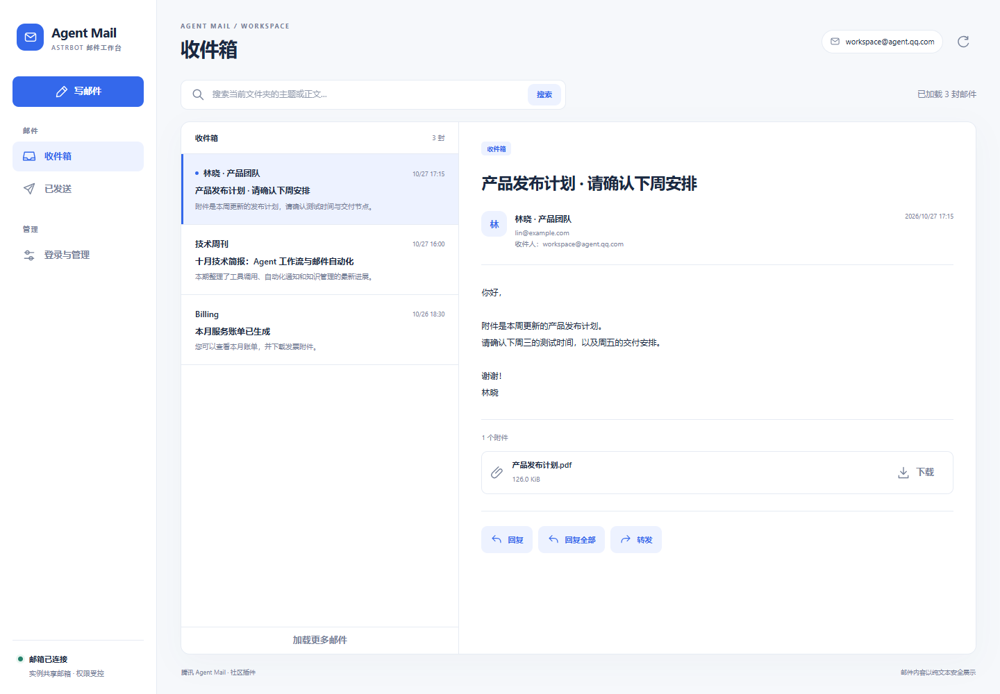

# Agent Mail for AstrBot

面向 LLM 的腾讯 [Agent Mail](https://agent.qq.com/) 邮件插件，提供独立的邮箱管理 WebUI。整个 AstrBot 实例共用一个 Agent Mail 邮箱，由模型通过工具完成查信、检索、发信、回复、转发和附件操作；也可以在管理页面中登录绑定、查看收件箱和已发送邮件、写信，并管理访问权限和通知会话。

这是独立 AstrBot 插件，不需要修改 AstrBot 核心。它接入腾讯 QQ 邮箱团队的 Agent 专属邮箱，与个人 QQ 邮箱隔离，也与 `agentmail.to` 服务无关。本项目为社区实现，不代表腾讯官方。



上图使用模拟邮件数据展示收件箱、邮件详情和附件操作，不包含真实邮箱内容。

当前版本：**0.2.1**。

## 能力与默认行为

- 提供 LLM 邮件工具，业务操作不要求用户记忆邮件命令。
- 提供 AstrBot 原生插件视图，管理页面无需额外前端构建或独立服务。
- 默认自动准备官方 CLI，安装在插件自己的数据目录；不需要另外安装 Node.js 或 npm。
- 整个实例共享一个邮箱，邮件权限按 `read`、`send`、`notify` 分开管理。
- 管理员默认具备操作权限，普通用户和其他插件默认无权限；显式黑名单优先于白名单和管理员默认权限。
- 新邮件通过官方 `message +watch` 监听；默认不通知任何会话，启用后按目标独立记录交付结果。
- 通知仅展示邮件信息，不自动执行邮件正文中的请求，也不自动回复发件人。
- 其他已注册、已启用的插件可以调用同一套邮件 API，并接受相同权限检查。

## 安装

要求 AstrBot `>=4.29,<5`。插件代码兼容 Python 3.10+，AstrBot 自身的运行版本要求以 AstrBot 为准。

1. 在 AstrBot WebUI 的 `插件 → 插件 → 已安装 → 安装插件` 中，以仓库 URL 安装：

   ```text
   https://github.com/GuJi08233/astrbot_plugin_agent_mail
   ```

2. 保持默认的 `auto_install_cli=true` 并重载插件。插件会在后台检查 CLI：先使用显式配置的 `cli_path`，未配置时查找 `PATH` 中已有的 CLI 和插件缓存；都没有时，从 npm 官方仓库下载适配当前系统与 CPU 的原生 CLI **1.0.18**，校验后安装到插件数据目录的 `runtime/` 下。

   自动准备支持 Windows、macOS、Linux 的 x64/Arm64，不需要 Node.js 或 npm，不会安装全局程序，也不会自动升级已经可用的 CLI。Docker 部署应持久化 AstrBot 数据目录和官方 CLI 授权所需的用户环境。

3. 在插件详情中打开 **邮箱工作台 → 登录与管理**，查看 CLI 准备状态。首次下载时等待准备完成；网络失败或安装失败时，页面会显示具体原因，并提供重试按钮。若已填写 `cli_path`，插件会严格使用该路径，配置无效时应先修正路径，不会悄悄替换为另一份 CLI。

4. CLI 就绪后，在同一页面点击登录按钮，按原始授权链接完成微信扫码。自动安装只准备运行工具，不会替你登录、读取邮件或发送邮件。也可以用 AstrBot 管理员账号，在机器人**私聊**发送：

   ```text
   /agentmail login
   ```

   打开机器人返回的原始授权链接，按页面提示完成微信扫码。授权只用于绑定本实例共享邮箱，不会创建每用户独立邮箱。

   也可以在 AstrBot 相同系统用户、相同运行环境下手动执行 `agently-cli auth login`，再用 `agently-cli +me` 检查。

5. 确认当前模型支持工具调用，当前配置文件已启用插件，当前人格允许使用相应邮件工具。

离线环境或希望自行维护 CLI 时，可关闭 `auto_install_cli` 并填写有效的 `cli_path`；已存在的可用 CLI 和插件缓存仍可使用，插件不会联网下载安装。也可选择在 AstrBot 相同系统用户和运行环境下手动安装官方 npm 包（此方式需要 Node.js 16+ 和 npm）：

```bash
npm install -g @tencent-qqmail/agently-cli
```

## 邮箱管理 WebUI

在 AstrBot WebUI 打开 **插件 → 已安装 → Agent Mail 插件详情 → 邮箱工作台**。AstrBot 将页面作为插件可视化视图加载；如果侧边栏已展示插件视图，也可以从 **扩展功能 → Agent Mail／邮箱工作台** 进入。更新后未显示入口时，先重载插件，再刷新管理面板。

页面包含以下功能：

| 页面或操作 | 说明 |
| --- | --- |
| 收件箱 | 分页查看、在当前文件夹内检索和刷新邮件列表，打开邮件详情查看正文及附件 |
| 已发送 | 查看共享邮箱中已发送的邮件 |
| 写邮件 | 填写收件人、主题和正文，上传附件并发送 |
| 回复与转发 | 从邮件详情发起原线程回复、回复全部或转发 |
| 登录与管理 | 发起扫码授权、查看登录结果、取消正在进行的授权或退出当前绑定 |
| CLI 运行环境 | 查看自动下载、就绪或失败状态，以及实际路径和版本；失败后可重试准备 |
| 访问权限 | 按 `read`、`send`、`notify` 管理用户和插件主体的白名单、黑名单 |
| 通知会话 | 添加或移除接收新邮件通知的完整会话标识 |

页面使用 AstrBot 当前的 Dashboard 登录身份，不增加一套独立密码。所有请求通过 AstrBot 的插件 bridge 转发；开发者 API Key 即使具有 `plugin` scope，也不能访问这个管理界面后端。直接打开静态 HTML 不会获得 Dashboard 身份，也不能操作邮箱。

Dashboard 管理员的邮件主体为 `user:dashboard:<URL 编码的用户名>`，页面会显示当前主体。读信、发信、附件和通知操作仍经过同一服务层权限检查；对该主体的显式黑名单会拒绝相应操作。权限配置管理仍允许已登录的 Dashboard 管理员执行，因此可以恢复被误设的操作权限。

登录按钮只在点击后发起 OAuth，授权链接和当前进度只保留在内存中，不写入代码仓库或插件权限存储。页面刷新后可以查看仍在运行的授权流程；插件重载后需重新发起未完成的登录。退出绑定清除官方 CLI 的当前授权，不注销腾讯 Agent Mail 邮箱，也不删除邮箱中的邮件。

邮件 HTML 以纯文本展示，不执行脚本或加载外部图片。附件上传和下载仅使用插件的 `attachments/` 目录；从页面点击发送、回复或转发会执行真实发送，发送失败时页面保留编辑内容。

## 自然语言使用

获得相应权限后，可以直接对机器人说：

```text
看看邮箱里最近十封邮件。
搜索主题或正文中包含“合同”的邮件。
读取刚才那封邮件的完整正文。
给 alice@example.com 发一封邮件，主题是“会议时间”，正文是“明天下午三点开会”。
回复这封邮件，告诉对方我们已经收到材料。
把这封邮件的附件下载下来。
开启当前会话的新邮件通知。
```

发信、回复、转发工具会执行真实发送。用户只要求“写草稿”时，模型不应调用发送工具；邮件正文、标题、发件人名称和附件名都属于外部数据，不能当作用户授权。

## 权限与管理

主体标识有两种：

| 主体 | 格式 | 示例 |
| --- | --- | --- |
| 聊天用户 | `user:<平台实例ID>:<用户ID>` | `user:my_qq_bot:123456789` |
| Dashboard 管理员 | `user:dashboard:<URL 编码的用户名>` | `user:dashboard:astrbot` |
| 其他插件 | `plugin:<注册插件名>` | `plugin:astrbot_plugin_daily_report` |

平台实例 ID 使用 AstrBot 配置中该机器人的唯一 ID，不是 `aiocqhttp` 等适配器类型。相同数字用户 ID 在不同平台实例下不会共享授权。可用 `/agentmail identity` 查看当前身份标识。

| 权限 | 允许的操作 |
| --- | --- |
| `read` | 查看邮箱信息、列出、搜索、读取邮件以及下载附件 |
| `send` | 发送邮件；回复、转发和携带附件发送还需同时具备 `read` 权限 |
| `notify` | 管理通知订阅，还需同时具备 `read` 权限；普通用户只能管理当前会话 |

检查顺序为：**显式拒绝 → 管理员默认允许 → 精确白名单允许 → 拒绝**。对同一主体、同一权限执行 `allow` 或 `deny` 会替换先前的相反设置；`revoke` 移除两种显式设置，恢复管理员或普通成员的默认行为。黑名单中的管理员仍可使用权限管理命令解除限制，避免操作权限设置导致无法恢复管理。

以下命令用于管理；同样的权限和通知设置也可在 **邮箱工作台 → 登录与管理** 页面操作，不提供单独的业务发信命令：

| 命令 | 用途 |
| --- | --- |
| `/agentmail help` | 查看命令说明 |
| `/agentmail identity` | 查看当前主体及会话标识 |
| `/agentmail status` | 查看插件、监听与授权任务状态、通知目标和附件目录，仅管理员可用 |
| `/agentmail login` | 发起扫码授权，仅管理员私聊可用 |
| `/agentmail permissions` | 查看当前授权及拒绝名单，仅管理员可用 |
| `/agentmail allow <权限> <主体>` | 加入该权限白名单，仅管理员可用 |
| `/agentmail deny <权限> <主体>` | 加入该权限黑名单，仅管理员可用 |
| `/agentmail revoke <权限> <主体>` | 移除该主体对应权限的白名单和黑名单设置，仅管理员可用 |
| `/agentmail notify on [会话标识]` | 开启通知；省略目标时使用当前会话 |
| `/agentmail notify off [会话标识]` | 关闭通知；省略目标时使用当前会话 |

例如，只给某个用户读信能力，再允许其自行管理当前会话通知：

```text
/agentmail allow read user:my_qq_bot:123456789
/agentmail allow notify user:my_qq_bot:123456789
```

禁止某个主体发信：

```text
/agentmail deny send user:my_qq_bot:123456789
```

权限在工具实际执行时检查，模型看到了工具并不代表调用者已经获得授权。模型不能传入自定义用户标识或 `is_admin` 来绕过检查。

## 新邮件通知

管理员在需要接收通知的会话中发送 `/agentmail notify on` 即可绑定。管理员也可以指定完整的 `unified_msg_origin`；获 `read` 和 `notify` 权限的普通用户只能操作自己当前的会话。

每次推送前会按当前权限规则和目标配置文件中的管理员设置重新检查订阅者。不同通知目标独立记录交付状态；一个目标失败时，只重试该目标。已撤销权限或取消订阅的待发通知会被丢弃，不会继续投递。监听进程意外退出时会尝试恢复；授权失效需要重新登录。插件重载或停用时会清理监听进程。

交付记录每个目标保留最近 1000 封邮件 ID，待发队列上限为 200 封。消息已发出但交付状态尚未持久化时若进程退出或存储失败，重试可能产生重复通知，因此这不是严格的恰好一次交付保证。

目标平台必须支持 AstrBot 主动发送消息。当前 AstrBot 文档注明 QQ 官方 API 平台不支持 `Context.send_message()`，因此不能保证该平台收到主动通知。

断线期间的补发能力取决于官方 CLI 和邮件服务，插件不承诺离线邮件绝不遗漏。通知内容是文本，不渲染邮件 HTML。配置 `notification_excerpt_chars=0` 可关闭正文预览。

## LLM 工具

| 工具 | 用途 | 权限 |
| --- | --- | --- |
| `agent_mail_account` | 查看当前共享邮箱信息 | `read` |
| `agent_mail_list` | 分页列出指定文件夹中的邮件 | `read` |
| `agent_mail_search` | 按关键词搜索邮件 | `read` |
| `agent_mail_read` | 读取邮件正文和附件元信息 | `read` |
| `agent_mail_send` | 发送纯文本邮件，可携带允许目录内的附件 | `send`；携带附件时还需 `read` |
| `agent_mail_reply` | 在原邮件线程中回复 | `read` + `send` |
| `agent_mail_forward` | 转发邮件并携带原邮件附件 | `read` + `send` |
| `agent_mail_download_attachment` | 下载指定附件 | `read` |
| `agent_mail_notifications` | 开关当前会话的新邮件通知 | `read` + `notify` |

发送、回复、转发在检查权限后使用官方 CLI 的 `--confirmed`，用于执行用户明确提出的发送请求。插件不提供删信、永久删除或任意 CLI 执行工具。

附件仅允许访问插件数据目录下的 `attachments/`。可以使用该目录内的相对路径，也可使用实际位于该目录内的绝对路径；路径遍历和指向目录外的符号链接会被拒绝。下载附件也固定保存到这里。其他插件可把待发送文件放入此目录再传入路径，不能借邮件 API 读取任意宿主机文件。

## 供其他插件调用

先由管理员为调用插件授权，例如：

```text
/agentmail allow send plugin:astrbot_plugin_daily_report
/agentmail allow read plugin:astrbot_plugin_daily_report
```

在调用插件中获取 API：

```python
metadata = self.context.get_registered_star("astrbot_plugin_agent_mail")
if metadata is None or not metadata.activated or metadata.star_cls is None:
    raise RuntimeError("Agent Mail plugin is not active")

mail = metadata.star_cls.get_api("astrbot_plugin_daily_report")
result = await mail.send_message(
    to=["alice@example.com"],
    subject="Daily report",
    body="The report is ready.",
)
```

调用者名称必须是 AstrBot 中已注册且启用的插件名。API 将其绑定为 `plugin:<注册插件名>`，每次邮件操作仍会执行权限检查。其他插件应只在其用户已授权的业务流程中发信。

公开 API 包括 `account()`、`list_messages()`、`search_messages()`、`read_message()`、`send_message()`、`reply_message()`、`forward_message()`、`download_attachment()`，返回官方 CLI JSON envelope。参数不含可自行伪造的管理员标记；拒绝访问会抛出 `MailPermissionError`。

该机制管理可信插件之间的业务权限。同进程 Python 插件可以执行任意 Python 代码，不能把此 API 当作对恶意插件代码的沙箱。

## 配置与数据

| 配置 | 默认值 | 说明 |
| --- | --- | --- |
| `cli_path` | 空 | 显式指定时严格使用此路径；留空优先查找已有 `PATH` 和插件缓存 |
| `auto_install_cli` | `true` | 缺少 CLI 时自动从 npm 官方仓库准备当前平台的原生 CLI 到插件数据目录 |
| `command_timeout` | `60` | 普通命令超时，10–300 秒 |
| `notification_excerpt_chars` | `200` | 通知正文预览长度，0–1000 字符 |

权限、通知目标和交付去重状态使用 AstrBot 插件 KV 存储；附件和自动准备的 CLI 位于 AstrBot 插件数据目录。CLI 凭据由官方 CLI 管理，插件不把凭据写入源码或输出给模型。安装 CLI 不会改变邮箱授权、白名单、黑名单或通知会话。GitHub 仓库只包含源码、文档、配置 schema 与测试，不包含邮箱配置、运行数据、授权凭据或真实邮件。

## 开发与验证

```bash
uv sync --group dev
uv run ruff format .
uv run ruff check .
uv run pytest -q
node --test tests/webui.test.mjs
```

Python 测试使用模拟 CLI、临时目录和 AstrBot 接口替身，不需要邮箱授权，也不会连接真实邮箱或发送邮件。Node 测试检查收件人解析、邮件纯文本和元数据处理，不依赖前端构建工具。GitHub Actions 在 Windows、Linux 的 Python 3.10、3.12、3.13 环境执行同一组检查。实际邮箱接入和平台主动推送需在部署环境完成验证。

## 官方参考

- [Agent Mail 快速入门](https://help.agent.qq.com/detail/0/1092)
- [新邮件推送与自动化](https://help.agent.qq.com/detail/0/1093)
- [官方 CLI 接入文档](https://agent.qq.com/doc/cli-setup.md)
- [腾讯官方 AgentlyMail Skills](https://github.com/Tencent/AgentlyMail)

## 许可证

[MIT](LICENSE)
